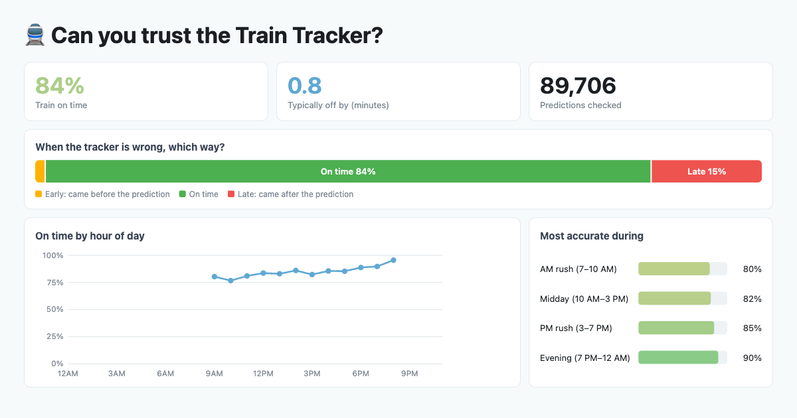

# CTA Arrival Prediction Accuracy

How often are the CTA's "arrives in N min" predictions right? This project polls the CTA Train Tracker and Bus Tracker APIs every three minutes for downtown Chicago, works out when each vehicle actually arrived, and scores every prediction made 2–15 minutes ahead as **early**, **on time** or **late**.

**Live results: https://yilunr.github.io/cta-arrival-accuracy/** (refreshed hourly)



## How it works

Built on Databricks Free Edition with a bronze → silver → gold pipeline.

| Layer | What happens |
|---|---|
| Bronze | `bronze` and `train_bronze` poll the CTA APIs (run together by `ingest_all`) and land raw predictions with Auto Loader |
| Silver | `silver` and `train_silver` clean predictions, infer each vehicle's actual arrival, and score every prediction |
| Gold | `gold` and `train_gold` build the accuracy, error-distribution, data-quality and rider tables |
| Publish | `publish_site` runs last in the hourly train job and exports compact summaries to `docs/data.json`, which the GitHub Pages site reads |

**Scoring:** error = actual arrival minus predicted arrival. Trains count as on time within 2 minutes, buses within 3. Settings live in `_common.py`.

**Inferring arrivals:** neither API reports arrivals, so a visit ends when the vehicle drops out of a stop's predictions, and the arrival time is the midpoint between the last sighting and the next poll. The Train Tracker has no trip ID, so a train visit is keyed on run number, line and platform.

**Coverage:** 46 train stations (98 platforms) in and around the Loop, plus Loop bus stops. State/Lake is excluded because the Train Tracker API rejects its station ID.

## Constraints and design decisions

- **Free Edition daily usage cap.** When the pipeline used up the day's compute, polling stopped until the quota reset the next morning, leaving gaps overnight and before 9 AM. Ingestion now runs every 3 minutes instead of 2 and pauses from 1 to 5 AM, when ridership is lowest, so the budget lasts through the rest of the day. The Data quality page shows exactly when polling ran.
- **One ingest job, hourly transforms.** A single `ingest_all` job polls buses and trains in parallel; silver and gold rebuild hourly rather than on every poll.
- **Static public page.** Sharing a Databricks dashboard requires an account and spends compute on every view, so the public page is plain HTML on GitHub Pages. Filters run in the browser against the exported summary, so viewers cost nothing.

## Repo layout

```
notebooks/   pipeline notebooks (Databricks source format)
docs/        GitHub Pages site (index.html, data.json, preview.png)
```

## Setup

1. Get a CTA [Train Tracker](https://www.transitchicago.com/developers/traintrackerapply/) key and [Bus Tracker](https://www.transitchicago.com/developers/bustracker/) key.
2. Store them in a Databricks secret scope named `cta` (train key: `train_api_key`).
3. Import `notebooks/` into Databricks. Create a job that runs `ingest_all` on the cron `0 0/3 0,5-23 * * ?`, plus hourly jobs for silver → gold, with `publish_site` as the last task of the train job.
4. For the public page, add a fine-grained GitHub token (Contents: read and write on this repo) as secret `cta` / `github_token`, then enable Pages on the `/docs` folder.

Never commit API keys or tokens.

## Data sources

CTA Train Tracker and Bus Tracker APIs, and the City of Chicago Data Portal for station locations. This project is not affiliated with the CTA.

## License

MIT, see [LICENSE](LICENSE).
