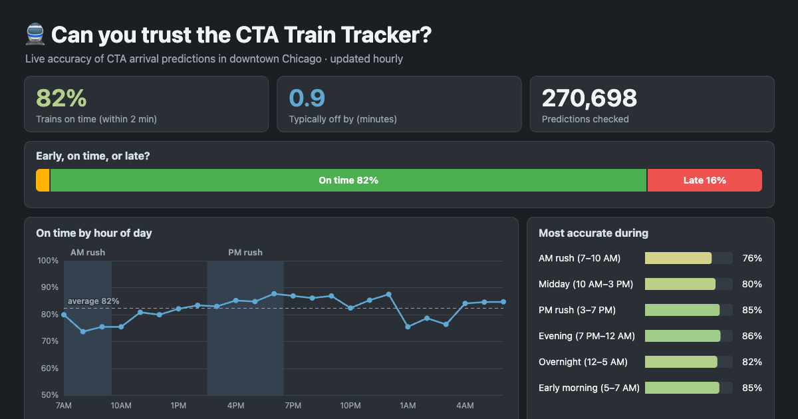

# CTA Arrival Prediction Accuracy

How often are the CTA's "arrives in N min" predictions right? This project polls the CTA Train Tracker and Bus Tracker APIs every two minutes, around the clock, for downtown Chicago, works out when each vehicle actually arrived, and scores every prediction made 2–15 minutes ahead as **early**, **on time** or **late**.

**Live results: https://yilunr.github.io/cta-arrival-accuracy/** (refreshed hourly)



## What's on the dashboard

| Tab | What it answers |
|---|---|
| 🚆 Train overview / 🚌 Bus overview | How often the tracker is right overall, early vs late, by hour of day and time of day, and on a map. Filter by area, time of day and day of week. |
| 🚆 Check your train platform / 🚌 Check your bus stop | Pick your platform or stop (click to choose or type to search) and get its numbers plus a plain-English takeaway. |
| 🔧 Data quality | How many vehicle visits were confirmed arrivals (the only ones scored), and whether polling ran every 2 minutes. |

Built for a commuter skimming on a phone:

- **"What the countdown means for your trip"**: each platform and stop gets a verdict: *Often early* (be there before the countdown says), *Often late* (leave a bigger buffer, avoid tight transfers), *Usually reliable*, or *About average*, plus its worst time of day and the sample size behind it.
- **Labels in the rankings**: *Runs late*, *Runs early* and *Reliable* tags flag the standouts, compared with every platform or stop under the same filters:
  - *Runs late*: late share at least 8 points above average
  - *Runs early*: early share at least 6% and at least 4 points above average
  - *Reliable*: at least 90% on time and 8 points above average
  - Nothing is labeled with fewer than 30 predictions behind it.
- **Platforms by station**: grouped by station, with CTA line-colour dots, a station picker/search, one-tap line filters, and the prediction count (`n = …`) in every bar.
- **On time by hour of day**: starts at 7 AM, with the AM and PM rush shaded and a dashed line for the average.

Early arrivals are treated as the riskier miss: a train that comes 3 minutes early is one you can miss, while a late one only means a longer wait.

## What counts as on time

| Mode | On time | Early | Late |
|---|---|---|---|
| Trains | arrived within **2 minutes** of the prediction | more than 2 minutes before it | more than 2 minutes after it |
| Buses | arrived within **3 minutes** of the prediction | more than 3 minutes before it | more than 3 minutes after it |

Error = actual arrival minus predicted arrival. Trains get the tighter window because they run on fixed track with signal-based tracking; buses sit in traffic. Only predictions made 2–15 minutes ahead are scored, the window a rider actually acts on. The thresholds live in `_common.py` (`TRAIN_ON_TIME_*_TOLERANCE_MIN`, `ON_TIME_*_TOLERANCE_MIN`).

## How it works

Built on Databricks Free Edition with a bronze → silver → gold pipeline and two jobs.

| Job | Schedule | Tasks |
|---|---|---|
| Ingest | every 2 minutes | `poll_cta`: calls both APIs in parallel and saves the raw responses as JSON files in a volume. No Spark work, so each run is cheap. |
| Transform | hourly at :10 | `load_landing` → (`train_silver` → `train_gold`) and (`silver` → `gold`) in parallel → `publish_site` once both are done |

| Step | What happens |
|---|---|
| `load_landing` | Auto Loader moves the hour's poll files into `bronze.bus_predictions_raw` / `bronze.train_predictions_raw` (exactly once), loads the poller's run logs into `ops.ingestion_runs` / `ops.train_ingestion_runs`, refreshes the stop list the poller reads, and re-runs stop discovery once a day |
| Silver | `silver` and `train_silver` clean predictions, infer each vehicle's actual arrival, and score every prediction |
| Gold | `gold` and `train_gold` build the accuracy, error-distribution, data-quality and rider tables |
| Publish | `publish_site` exports compact summaries to `docs/data.json`; the GitHub Pages site reads that file and applies its filters in the browser |

**Inferring arrivals:** neither API reports arrivals, so a visit ends when the vehicle drops out of a stop's predictions, and the arrival time is the midpoint between the last sighting and the next poll. A visit only counts as arrived if the next poll came within 4.5 minutes and the vehicle was close on its last sighting (within 2,500 ft for buses; due or predicted within 4 minutes for trains). The Train Tracker has no trip ID, so a train visit is keyed on run number, line and platform.

**Coverage:** 46 train stations (98 platforms) in and around the Loop, plus Loop bus stops. State/Lake is excluded because the Train Tracker API rejects its station ID.

## Constraints and design decisions

- **Free Edition daily usage cap.** Databricks Free Edition stops all compute once the day's quota is used, and it resets in the morning. The first version ran a full Spark ingest (API call plus an Auto Loader write to Delta) on every poll, so the budget ran out each evening and polling stopped until the reset, leaving no overnight or morning-rush data. Breaking usage down by job in `system.billing.usage` showed polling was the biggest cost. Splitting it into a plain-Python poller and an hourly loader cut the cost of each poll by about 95%, which made 2-minute, 24-hour polling fit inside the cap.
- **Hourly transforms in one job.** Bus and train share one hourly job so each hour pays for one set of task start-ups, and the loader runs Auto Loader directly instead of launching child notebooks.
- **Static public page.** Sharing a Databricks dashboard requires an account and spends warehouse compute on every view, so the public page is plain HTML on GitHub Pages reading an hourly JSON export. Viewers cost nothing.

## Repo layout

```
notebooks/   pipeline notebooks (Databricks source format)
  _common.py           shared settings, table names and API clients
  poll_cta.py          every-2-minute poller (raw files only)
  load_landing.py      hourly loader: files -> bronze, run logs -> ops
  bronze.py, train_bronze.py      setup, stop discovery and (legacy) in-notebook polling
  silver.py, train_silver.py      cleaning, arrival inference, scoring
  gold.py, train_gold.py          dashboard tables
  publish_site.py      hourly export to docs/data.json
  ingest_all.py        legacy: the old per-poll Spark ingest, replaced by poll_cta
docs/        GitHub Pages site (index.html, data.json, preview.png, avatar.jpg)
```

## Setup

1. Get a CTA [Train Tracker](https://www.transitchicago.com/developers/traintrackerapply/) key and [Bus Tracker](https://www.transitchicago.com/developers/bustracker/) key.
2. Store them in a Databricks secret scope named `cta` (bus key: `api_key`, train key: `train_api_key`).
3. Import `notebooks/` into Databricks and run `bronze` and `train_bronze` once with `rediscover = true` to create the tables and discover stops.
4. Create the ingest job: notebook `poll_cta`, cron `0 0/2 * * * ?`.
5. Create the transform job: cron `0 10 * * * ?`, tasks as in the table above, with `load_landing`'s `mode` set to `both`.
6. For the public page, add a fine-grained GitHub token (Contents: read and write on this repo) as secret `cta` / `github_token`, then enable Pages on the `/docs` folder.

Never commit API keys or tokens.

## Data sources

CTA Train Tracker and Bus Tracker APIs, and the City of Chicago Data Portal for station locations. This project is not affiliated with the CTA.

## Author

Built by **Yilun Ruan**, Data Engineer (MSCS, Georgia Tech). Questions or ideas: [LinkedIn](https://www.linkedin.com/in/yilun-ruan/).

## License

MIT, see [LICENSE](LICENSE).
